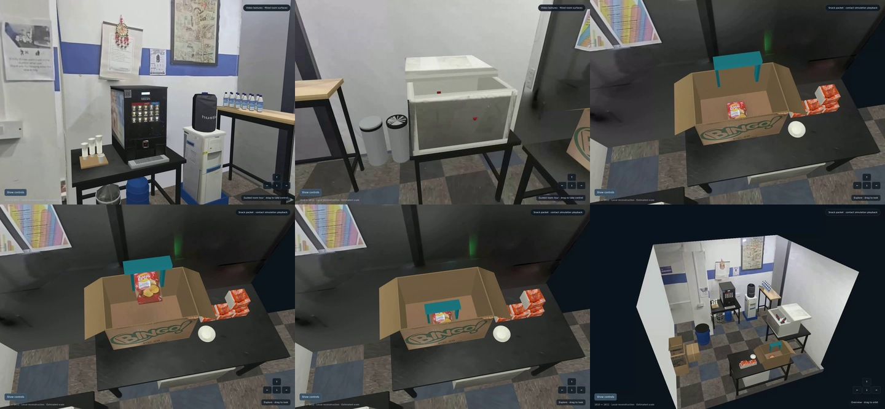
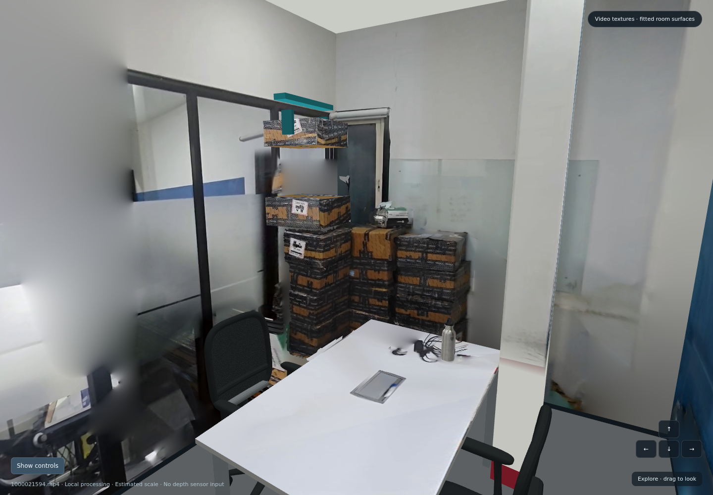
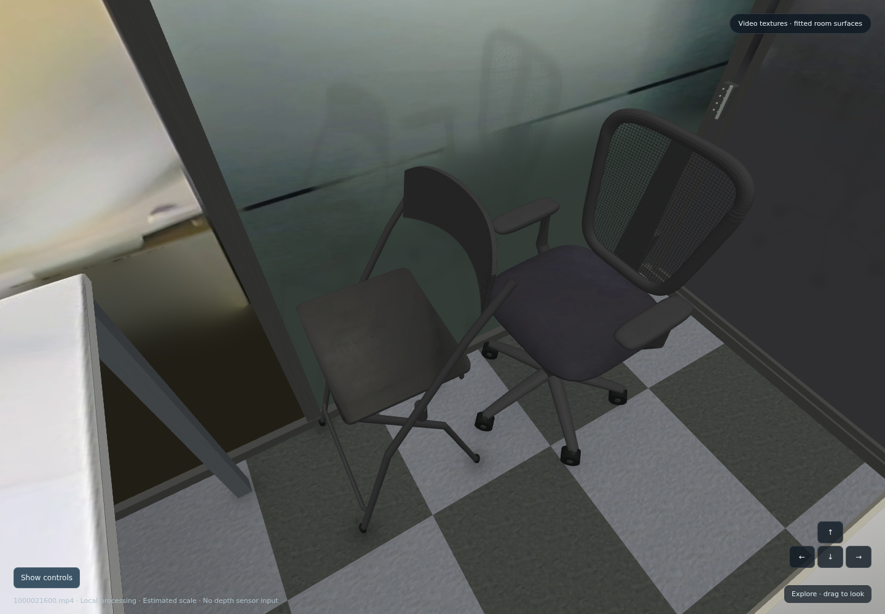
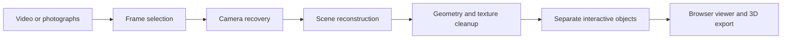

# Real2Sim

### Capture a real space. Explore it in 3D. Bring its objects to life.

Real2Sim turns room videos and photographs into interactive 3D environments: photographic rooms you can navigate, chairs you can move, and objects you can pick up in simulation.

The project brings together camera recovery, scene reconstruction, texture cleanup, fitted geometry and object interaction. The demonstrations below show completed reconstruction experiments; the current pipeline packages those ideas into configurable stages for new captures.

[**Watch the demo**](https://github.com/shreyasajal/real2sim/raw/refs/heads/main/demo/media/pantry-tour.webm) · [**Explore the 3D scene**](#try-the-interactive-scene) · [**How it works**](#how-it-works) · [**Setup**](docs/SETUP.md)

[](https://github.com/shreyasajal/real2sim/raw/refs/heads/main/demo/media/pantry-tour.webm)

*One room reconstructed from two videos, with a continuous walkthrough and a simulated snack pickup. Click the preview to open the approximately 60-second recording.*

## See what we built

| Office: movable objects | Office: repaired furniture |
| :---: | :---: |
| [](https://github.com/shreyasajal/real2sim/raw/refs/heads/main/demo/office/assets/room.glb) | [](https://github.com/shreyasajal/real2sim/raw/refs/heads/main/demo/office-tour/assets/room.glb) |
| A separate carton with a pickup animation, plus two chairs that roll and swivel. | Repaired chair geometry, photographed wall detail and an animated chair. |
| [Download animated GLB](https://github.com/shreyasajal/real2sim/raw/refs/heads/main/demo/office/assets/room.glb) | [Download animated GLB](https://github.com/shreyasajal/real2sim/raw/refs/heads/main/demo/office-tour/assets/room.glb) |

| Demonstration | What to open |
| --- | --- |
| **Pantry tour and snack pickup** | [Watch the video](https://github.com/shreyasajal/real2sim/raw/refs/heads/main/demo/media/pantry-tour.webm) · [Download animated 3D scene](https://github.com/shreyasajal/real2sim/raw/refs/heads/main/demo/pantry/assets/room.glb) |
| **Office carton and chair interactions** | [Preview](demo/media/office-preview.png) · [3D scene with three animation clips](https://github.com/shreyasajal/real2sim/raw/refs/heads/main/demo/office/assets/room.glb) |
| **Second office and chair motion** | [Preview](demo/media/chairs-preview.png) · [Animated 3D scene](https://github.com/shreyasajal/real2sim/raw/refs/heads/main/demo/office-tour/assets/room.glb) |
| **Object reconstruction from four images** | [Can grasp preview](demo/media/can-preview.png) · [Textured can model](https://github.com/shreyasajal/real2sim/raw/refs/heads/main/demo/can/assets/can.glb) |

GLB downloads contain embedded textures. Open them in a compatible 3D viewer or Blender; select an animation clip to inspect motion. The can GLB is a static model—the grasp is shown in the preview and documented in the earlier experiments.

## Try the interactive scene

The supplied pantry viewer runs locally and includes both navigation and pickup playback:

```bash
git clone https://github.com/shreyasajal/real2sim.git
cd real2sim
python3 -m http.server 8080 --bind 127.0.0.1
```

Open **http://127.0.0.1:8080/demo/pantry/viewer.html**.

| Control | Action |
| --- | --- |
| **Guided tour** | Follow the continuous camera route through the room |
| **Drag** | Look around |
| **WASD / arrow keys** | Move through the scene |
| **Q / E** | Adjust camera height |
| **Pick up snack** | Play the recorded contact simulation |
| **Pause / reset** | Inspect or restart the interaction |
| **Overview / room cutaway** | Inspect the room and object layout |

You can also open `demo/pantry/viewer.html` directly in a desktop browser. Its scene is embedded and works offline. The screenshot and recording links above are previews; GitHub's file browser does not execute the HTML viewer.

## What changed between a scan and an interactive room?

- **Continuous surfaces.** Fragmented walls and tables were replaced with fitted structural surfaces. Calibrated photo projection, foreground exclusion and blending reduce gaps, texture seams and duplicated silhouettes.
- **Recognizable materials.** Wall signs, packaging and object fronts use the original capture imagery. Weakly observed carpet and blinds are completed from photographed material samples.
- **Complete furniture.** Broken chair fragments were replaced with fitted seats, backs, arms, bases and wheels. Parts retain individual transforms for roll and swivel animation.
- **Separate objects.** Selected cartons and the snack packet have their own visual meshes and collision proxies, allowing interaction independently of the room.
- **Smoother navigation.** Guided paths, camera transitions and movement checks make the scene easier to explore continuously.
- **More reliable alignment.** Repeated artwork on different pantry cartons caused a false match between videos. Additional turn frames and scene-specific match exclusions repaired the camera connection.

[Read the implementation history and supporting checks](reference/ARCHIVE_IMPROVEMENTS.md).

## How it works



The completed mesh demonstrations use **COLMAP/PyCOLMAP** for camera estimation, **OpenMVS** for multi-view depth and meshing, and fitted surface/object completion where observations are incomplete. Earlier RGB-D experiments use **Open3D TSDF fusion**. **MuJoCo** supplies contact-based pickup playback; chair movement is authored animation.

The current pipeline also provides adapters for **Nerfstudio Splatfacto**, **Blender repairs** and **SAM 3D object reconstruction**. These are a separate configurable workflow. The historical screenshots above are examples from the completed mesh experiments, rather than evidence that every current adapter has been rerun end to end.

[Pipeline stages](docs/PIPELINE.md) · [Earlier reconstruction methods](reference/ARCHIVE_METHODS.md) · [Environment setup](docs/SETUP.md)

## Recorded results

The combined pantry experiment used two ordinary RGB videos, without supplied sensor depth or a known physical measurement.

| Measure | Recorded result |
| --- | ---: |
| Selected frames | 214 |
| Registered camera views | 177 |
| Sparse 3D points | 31,701 |
| Mean reprojection error | Approximately 0.822 px |
| Fused dense points | 2,205,365 |
| Exported scene | 29 mesh nodes; 38,638 triangles |
| Demo recording | 59.92 seconds |
| Simulated snack lift | Approximately 0.464 m at estimated scene scale |

The pickup commands the gripper while the object moves as a free rigid body. A zero-friction control fails to lift the packet, confirming that the demonstrated grasp depends on the modeled contact interaction. This is a simulation check, not a physical robot success rate.

## Work with your own capture

Start by checking the environment and editing a scene configuration to point to your input video:

```bash
python3 room2sim.py doctor
python3 room2sim.py init --config configs/office.json --run runs/office-v1
python3 room2sim.py ingest --run runs/office-v1
python3 room2sim.py reconstruct --run runs/office-v1
python3 room2sim.py splat --run runs/office-v1
python3 room2sim.py repair --run runs/office-v1
python3 room2sim.py objects --run runs/office-v1
python3 room2sim.py package --run runs/office-v1 --output site/office-v1
python3 room2sim.py serve site/office-v1
```

These commands require the dependencies and external environments described in [SETUP.md](docs/SETUP.md). Review the [pipeline instructions](docs/PIPELINE.md) before executing them. Repair coordinates, object masks and alignment settings must be fitted to the capture; example configurations are starting points.

## Why this matters for simulation

A captured room gives interaction experiments a real spatial context. It helps inspect object placement, camera routes, collision proxies and pick-and-place sequences before moving to a physical setup. A shared scene also makes demonstrations repeatable and lets collaborators inspect the same environment.

Robot learning would add measured calibration, a robot model, task definitions, policy training and real-world evaluation. Those steps remain beyond the demonstrations here.

## Scope and validation

Room scale, hidden geometry and some material regions are estimated. Grasp playback uses rigid collision proxies and assumed physical parameters; it is replayed in the browser. Chair motion is authored animation. The project does not claim a measured digital twin, live browser grasp physics, a trained robot policy or an Isaac-validated task.

The current pipeline's checks and execution status are recorded in [VALIDATION.md](docs/VALIDATION.md). The earlier scene improvements and recorded results are documented separately in [the reconstruction archive](reference/ARCHIVE_IMPROVEMENTS.md).

## Repository guide

| Directory | Contents |
| --- | --- |
| `src/room2sim/` | Pipeline CLI, stage orchestration, scene packaging and validation |
| `blender/` | Geometry repair and mesh export |
| `backends/` | Object reconstruction adapter |
| `configs/` | Scene recipes and repair/object templates |
| `demo/` | Supplied models, photographs of results, tour recording and offline pantry viewer |
| `site/` | Exported browser packages |
| `reference/` | Earlier methods, improvements and implementation notes |
| `tests/` | Pipeline and data-integrity tests |
| `docs/` | Setup, stage execution and validation instructions |

## Attribution

Room and pantry visuals derive from supplied captures. The can example uses photographs from the **YCB Object and Model Set**, attributed to Calli, Singh, Walsman, Srinivasa, Abbeel and Dollar (2015), under **CC BY 4.0**. See [asset attribution](demo/media/ATTRIBUTION.txt), [the can source record](demo/media/can-sources.json) and [archive attribution](reference/ARCHIVE_THIRD_PARTY.md).
