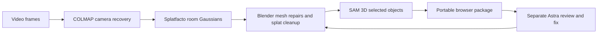

# Room2Sim Pipeline

**Room video → Gaussian splats → reviewed Blender repairs → individual SAM 3D objects → an interactive browser environment.**

This is an executable project scaffold with real stage adapters, portable scene packages, an offline browser viewer, supplied demo assets, and separate GPT-6 Astra review/fix tools. Robot policy training is deferred.


*Above: an existing result from `room2sim_repository.zip`, included as reference evidence. It was not produced by running the new pipeline.*

## Run immediately

No installation commands are run automatically. Assume prerequisites are already available; [requirements and environment checks](docs/SETUP.md) describe what the person executing each stage needs to provide. Python 3.10+ is sufficient to package and serve the included demos. The viewer is already built and requires no internet at runtime.

```bash
cd room2sim-pipeline
python3 room2sim.py doctor
# Ready-made desk splat + an illustrative movable cube:
python3 room2sim.py serve site/desk
```

Open **http://127.0.0.1:8080**. Drag to orbit, scroll to zoom, switch to walk mode, select an object, move/lift/rotate it, reset it, show interaction bounds, and export placements or screenshots.

Alternatively, inspect the supplied office mesh with a movable carton or pantry mesh with a movable packet:

```bash
python3 room2sim.py serve site/office --port 8081
python3 room2sim.py serve site/pantry --port 8082
```

To create a fresh, shareable demo package:

```bash
python3 room2sim.py demo --scene desk --output site/my-desk
python3 room2sim.py validate site/my-desk
python3 room2sim.py serve site/my-desk
```

`site/<scene>/` contains its own HTML, JavaScript, vendor libraries, assets, manifest and checksums. Share that folder or serve it with static hosting. Serve over HTTP; browser workers and module imports need a server.

## Execute on the supplied videos

The local checkout includes `inputs/office.mp4` from `1000021594.mp4` and `inputs/desk.mp4` from the comparison capture. Inputs are ignored by Git. For a fresh checkout, put your videos there or change config paths.

The reconstruction backend is **Nerfstudio Splatfacto**, matching the supplied desk export. [Backend selection](configs/backend-selection.json) records the selection and provenance. This is based on the supplied proposal/export; a new Astra selection call has not been claimed.



With the reconstruction, Blender and SAM 3D environments already available:

```bash
python3 room2sim.py init --config configs/office.json --run runs/office-v1
python3 room2sim.py ingest --run runs/office-v1
python3 room2sim.py reconstruct --run runs/office-v1
python3 room2sim.py splat --run runs/office-v1
# Review before replacing geometry. An empty repair stage needs no Blender.
python3 room2sim.py repair --run runs/office-v1
python3 room2sim.py objects --run runs/office-v1
python3 room2sim.py package --run runs/office-v1 --output site/office-v1
python3 room2sim.py serve site/office-v1
```

Or execute the same configured stages in sequence:

```bash
python3 room2sim.py run --config configs/office.json --run runs/office-v2 --output site/office-v2
```

Splat optimization is part of reconstructing appearance. No robot policy or task training is included.

See [stage instructions](docs/PIPELINE.md) for table replacement, object masks, background cleanup, alignment, stage receipts and failure recovery. `configs/repair.example.json` and `configs/objects.example.json` are **templates**, with example coordinates that must be fitted to your scene. They are not applied automatically.

## Separate Astra review and fixing

These tools are outside the reconstruction package and do not run automatically. They read screenshots, console errors, source frames, Gaussian bounds and exact mesh names. Scene repairs use typed operations, not model-authored Blender scripts. Browser code changes are written into a separate candidate folder.

```bash
# Uses already installed Node Playwright and browser; no installation attempt:
node agents/capture.mjs site/office-v1 review-work/before
python3 agents/review.py prepare --package site/office-v1 \
  --evidence review-work/before --output review-work/request \
  --source-images runs/office-v1/frames/capture-00-frame-000020.jpg
# Set OPENAI_API_KEY in your own environment before this explicit API call.
python3 agents/review.py call review-work/request
python3 agents/review.py apply --package site/office-v1 \
  --review review-work/request/review.json --output site/office-candidate
node agents/capture.mjs site/office-candidate review-work/after
```

Repeat `prepare` and `call` with the new evidence to review the candidate. There is no automatic paid retry, promotion or deployment. [Review workflow](docs/REVIEW.md) also documents the separate `agents/fix_browser.py` tool and a prompt for using this repo from a GPT/Codex environment.

## Supplied demonstration material

- [Office carton interaction preview](demo/media/office-preview.png) and [chair repair preview](demo/media/chairs-preview.png).
- [Pantry walkthrough recording](demo/media/pantry-tour.webm).
- [Supplied user recording](demo/media/supplied-demo.mov): copied from `~/Downloads/random_py_demo_2.mov`. The requested `~/Downloads/random_py_2.mov` was absent; the alternative is explicitly recorded in [provenance](demo/media/provenance.json).
- [Existing desk reconstruction metadata](demo/desk/source-metadata/manifest.json): 228,043 Gaussians, 7,000 Splatfacto iterations, unverified scale.


The MOV is large and retained without transcoding. `.gitattributes` marks large assets for Git LFS if you publish the project. Use the smaller WebM for ordinary README demo sharing. Archive and input-video attribution is preserved in [THIRD_PARTY.md](THIRD_PARTY.md).

## What is verified

The Python contract tests and JavaScript parser/interaction tests pass, all three demo packages pass hash/asset validation, and the offline viewer build completes using already cached Three.js bytes. The desk PLY is decoded as 228,043 Gaussians.

The current restricted workspace blocks localhost serving and browser launch. Browser screenshots therefore remain pending. The new video reconstruction, Blender stage, SAM 3D inference and live Astra calls were not executed here. [Validation report](docs/VALIDATION.md) distinguishes these checks from historical demo evidence.

```bash
python3 -m unittest discover -s tests -v
node --test web/tests/*.test.mjs
python3 room2sim.py validate site/desk
```

The browser renderer projects anisotropic Gaussian covariance and sorts splats globally. It uses **SH degree 0** for a lightweight preview; original higher-order SH is preserved in the PLY. Selected objects have kinematic movement and approximate box bounds. Scale, physical dynamics, full room collision, hidden-surface completion and robot training require additional work and validation.

## Project layout

```text
src/room2sim/       CLI, stage orchestration, PLY edits, manifests and validation
blender/           Deterministic table/box/cylinder repair and mesh export
backends/          SAM 3D Objects inference adapter for its isolated environment
agents/            Browser evidence, Astra scene repair and browser code proposals
web/               Offline Gaussian + mesh viewer and interaction controls
configs/           Office/desk recipes and explicit repair/object templates
demo/              Supplied splats, meshes, recordings, previews and attribution
site/              Ready-to-serve portable demo packages
inputs/            Local videos; ignored by Git
reference/         Proposal, archive methods, prior implementation notes
tests/             Pipeline and data integrity contracts
docs/              Setup, execution, review and validation instructions
```
