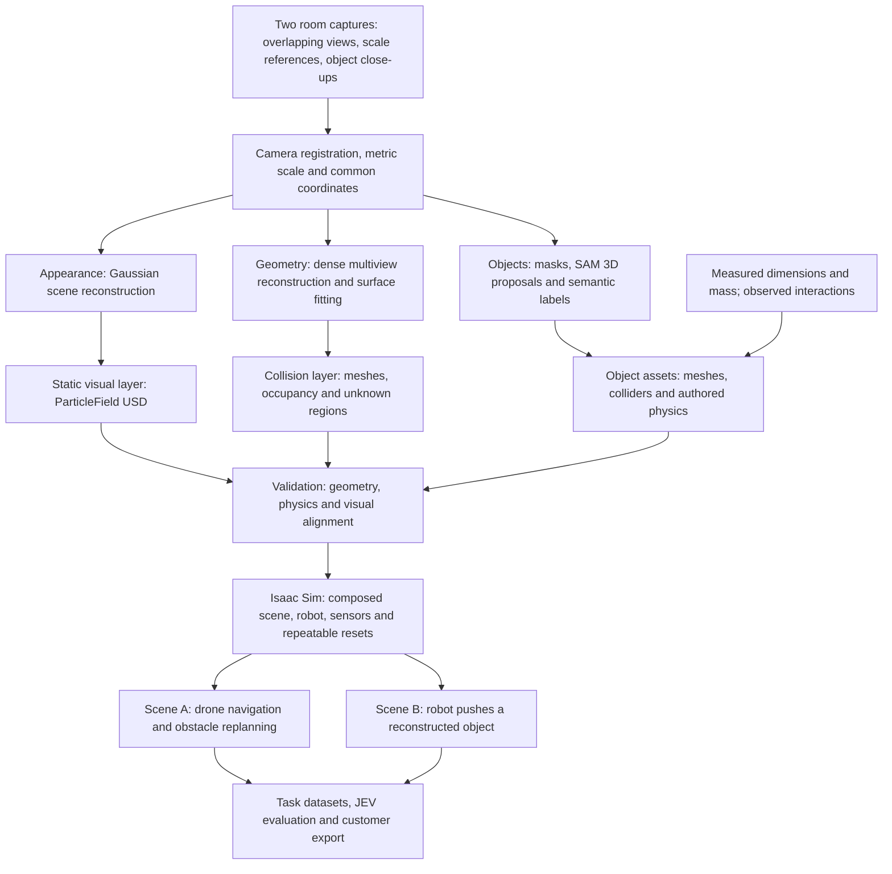
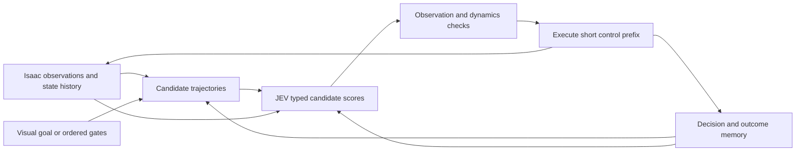

**Room → Robot: turn a captured workplace into a testable robot simulation**

Proposal prepared 10 October 2026. This is a proposed architecture and delivery plan; its targets are not measured results. The immediate deliverable is two reconstructed rooms running documented tasks in Isaac Sim, with evidence for appearance, geometry, and selected object interactions.

**Recommendation.** Proceed with Gaussian splatting as the main visual representation, backed by a metric geometric map and individually authored physical objects. The product should let a company capture its own environment, review the reconstruction, assign robot tasks, and export a repeatable simulation package. The strongest demonstration is a recognizable room in which a robot completes a task and reacts correctly when an object moves.

Three changes make the proposed approach credible: capture more than a single circular pass; treat generated object geometry and model-inferred physical properties as hypotheses; and validate the geometry used for contact separately from the rendered image. Sharp-looking edges alone do not establish accurate distances or collision boundaries.

**What we can reuse.** SOUS VIDE is a relevant research starting point: its FiGS simulator combines a reconstructed Gaussian scene with simplified drone dynamics, and its training workflow learns a visual policy from an MPC expert. Its capture setup uses video and an ArUco reference. Its published results establish feasibility on the authors' system; they do not establish compatibility with a DJI Mini 2 or arbitrary robot. [SOUS VIDE project](https://stanfordmsl.github.io/SousVide/).

Use that capture/training pattern as a reference, while building the customer-facing scene package around OpenUSD and Isaac Sim. The repository provides FiGS examples and policy notebooks, with a separate ACADOS dependency. Reusing it requires an adapter and environment isolation rather than assuming it is a complete room-to-Isaac importer. [SOUS VIDE repository](https://github.com/StanfordMSL/SousVide).

**Architecture.** The same calibrated observations feed three representations. All three share metres, a common world frame, stable object IDs, and a recorded transform into the simulator.


Editable versions: [SVG](pipeline.svg), [Mermaid source](pipeline.mmd). The diagram describes the proposed system, not a completed reconstruction.



| Representation | What it supplies | What we must verify |
| --- | --- | --- |
| Gaussian splats | Realistic camera observations and novel viewpoints within captured coverage | Held-out views, edge stability, floaters, object removal, runtime |
| Dense point cloud / surface mesh | Measured structure, dimensions, surface locations | Scale, missing surfaces, thin obstacles, uncertainty |
| Collision and occupancy layer | Contacts, ray queries, traversability and task clearance | Agreement with measured surfaces; explicit unknown space |
| Separate object assets | Objects that can move, collide, and optionally articulate | Geometry, pose, mass, inertia, contact material, joints |
| Scene/task package | Repeatable robot tests and training interfaces | Reset behavior, observation/action contracts, outcomes and provenance |

**Capture plan for the two rooms.** A translated orbit is useful, but one orbit cannot see behind furniture, underneath tables, or above cabinets. A rotation from one position also provides little triangulation baseline. COLMAP recommends overlapping observations from different camera positions; its pipeline estimates camera poses and can build dense geometry from multiview stereo. [COLMAP capture and reconstruction guidance](https://colmap.github.io/tutorial.html).

For this prototype, use the following acquisition recipe as a starting point and adjust it after a quick reconstruction preview:

1. Choose two modest, distinct rooms with visible texture and controllable lighting. Pick one box or similar rigid object for the interaction demonstration. Start with rigid, opaque objects; add reflective or deformable objects only after the baseline works.
2. Record the camera settings and retain original footage. Prefer slow, steady translation, stable focus/zoom, and consistent exposure where supported. A handheld capture with the drone camera and motors off, if the camera supports recording that way, or a phone is sufficient for this stage.
3. Place a measured ArUco board or equivalent scale reference where multiple views can see it. Record several independent dimensions: room width, doorway width, table height, and the selected object's dimensions. Use one set for alignment and reserve other measurements to check accuracy.
4. Capture a perimeter pass, a second pass at a different height, and cross-room passes through the intended robot operating region. Add views of doorway edges, chair legs, shelf ends and the floor/wall junction. Keep the camera physically moving while preserving overlap.
5. For each selected movable object, capture close views around its visible sides. Capture the background with that object removed, and then record the object in place. This prevents the old object from remaining visibly embedded in the room when its simulated copy moves.
6. Record a separate evaluation pass. Do not train the appearance model on these frames. Preserve timestamps and identify its camera poses for matched-view comparisons.
7. Run a quick pose/coverage check before leaving the room. Revisit unregistered areas and critical occlusions instead of hoping additional training will recover unseen surfaces.

A planning allowance is 3–8 minutes of room footage plus close-ups per room, yielding roughly 300–1,000 useful keyframes after selection. These are initial collection budgets, not quality guarantees. Keep the sharp, spatially useful frames; do not equate every video frame with a new viewpoint. Survey-grade edges may require an additional depth sensor or manual measurements.

**Reconstruction and the Isaac connection.** Start with a very small sample asset and prove the complete import path before reconstructing both rooms. The first acceptance test is an actual Isaac render containing a splat background, an inserted mesh, correct occlusion, and working mesh collision.

The preferred initial backend is COLMAP-compatible camera reconstruction followed by NVIDIA 3DGruT/3DGUT training and `ParticleField` USD export. NVIDIA documents this export route and recommends ParticleField for new Isaac Sim 6 assets. Keep a generic Gaussian PLY output for other viewers, with its exact attribute schema recorded. [3DGruT training and export](https://github.com/nv-tlabs/3dgrut).

Isaac's documented neural-volume workflow can render compatible particle fields together with polygonal scene content. Pin the exact tested Isaac/exporter versions; verify RGB, occlusion, depth conventions, segmentation availability, and headless capture independently. A scene opening in a viewer does not by itself validate all robot sensor outputs. [Isaac Sim neural volume rendering](https://docs.isaacsim.omniverse.nvidia.com/latest/assets/usd_assets_nurec.html).

For the metric geometry branch, fuse multiview depth where observations support it, fit simple planes for walls and floors, preserve measured openings, and create a collision mesh at the resolution needed by the robot. Use manually measured primitives for a few critical surfaces if automatic reconstruction is poor, and record that intervention. Mark unobserved regions as unknown. Splat centres are rendering primitives, not a guaranteed surface point cloud.

NVIDIA also provides a reconstruction workflow using stereo cameras, depth estimation and mesh generation. That is a useful later capture tier, but its stereo inputs are different from the proposed monocular drone video. [NuRec stereo workflow](https://docs.nvidia.com/nurec/robotics/neural_reconstruction_stereo.html).

If native splat import fails its bounded compatibility test, retain a textured mesh scene for the Isaac demonstration and a separate splat viewer for appearance review. Label that fallback accurately. It would demonstrate a reusable scene pipeline, while native splat rendering inside Isaac would remain unfinished.

**Turning reconstructed objects into physical assets.** Treat SAM 3D Objects as an object reconstruction proposal stage. It accepts image/mask inputs and predicts shape, appearance and layout. Match each proposal against multiple captured views and measured dimensions before placing it in the scene. Hidden surfaces can be plausible completions without being measured surfaces. [Meta SAM 3D Objects](https://github.com/facebookresearch/sam-3d-objects).

For the first two rooms, process only 3–5 selected objects per room, with one or two becoming dynamic. Associate masks across views, assign one persistent ID per object, fit scale and pose to the registered scene, then author a simplified collider. Keep fitted geometry and generated completion distinguishable in the asset record.

Use a clean static background and separate object visuals. When an object moves, its visual representation and collider must follow the same rigid-body transform. Check for a duplicated original, missing background, baked shadows and incorrect occlusion from several viewpoints. Start with a textured mesh for dynamic object rendering if moving an object splat adds avoidable integration risk.

A drawer or door additionally needs an articulated assembly: separate moving parts, a joint axis, limits and contact behavior. A generated closed-object mesh does not establish those quantities. Make one manually verified articulation a stretch milestone, after the rigid-box interaction is stable.

Isaac distinguishes visible geometry from collision geometry and exposes mass, centre of mass and inertia for inspection. Use simple or convex collision shapes for dynamic assets where appropriate; choose more detailed collision only where the task requires it. [Isaac asset inspection](https://docs.isaacsim.omniverse.nvidia.com/6.0.0/openusd_tuning_tutorials/tutorial_03_inspect_asset.html), [robot simulation tips](https://docs.isaacsim.omniverse.nvidia.com/6.0.0/robot_simulation/robot_simulation_tips.html).

**Role of GPT-6 and physical-property estimation.** Use the requested vision-language model through a replaceable semantic adapter; pin the actual available model and API configuration during implementation. This proposal does not assume a particular model endpoint has been provisioned. Supply object crops, several views, dimensions, and any available product information.

The adapter can suggest object class, likely material, movable/static status, possible interaction types and missing measurements. It can supply broad mass or friction priors for review. It cannot establish an object's true mass from appearance: visually identical objects may be empty, filled, hollow, or made from different materials. Store mass in kilograms; physical weight depends on gravity.

| Property | Initial source | Evidence needed for a calibrated asset |
| --- | --- | --- |
| Object category | Vision-language model / user label | Cross-view review and correction |
| Dimensions and pose | Scaled reconstruction | Independent physical measurements |
| Mass | Scale measurement or documented product value; otherwise an explicit prior | Measured mass for the demo interaction object |
| Friction | Material prior | Repeatable sliding or tilt experiment with relevant surfaces |
| Centre of mass / inertia | Geometry-based approximation and measured mass | Motion tests if these properties materially affect the task |
| Joint axis and limits | Visible structure / authoring | Measurements and a real motion sequence |
| Affordance | Semantic suggestion | Successful task-specific simulator test and, later, real validation |

Passive motion video alone does not generally identify mass when the applied forces are unknown. Measure the selected demo object's mass directly. Use observed slide or rotation tests to fit the remaining response parameters, then check a separate interaction sequence. When a property remains uncertain, carry a range and randomize within it; do not report a model's self-assigned confidence as calibrated probability.

A proposed object record is below. Null fields mean not yet measured; inferred labels are not ground truth.

```yaml
object_id: room_b_box_01
category:
  value: storage_box
  source: vlm_suggestion
  review_status: pending
geometry:
  mesh: objects/box_01/visual.usd
  collider: objects/box_01/collision.usd
  origin: multi_view_fit_of_sam3d_proposal
  dimensions_m: null
  world_from_object: null
physics:
  mass_kg:
    value: null
    source: unmeasured
  friction:
    range: null
    source: unmeasured
  inertia_source: pending_geometry_and_mass
validation:
  measured: false
  interaction_test_passed: false
```

**Two-scene demonstration.** Use different layouts. Two rooms demonstrate repeatability and an initial transfer test; they are too few to substantiate broad enterprise or robot generalization.

| Scene | What the audience sees | Technical deliverable |
| --- | --- | --- |
| A: workspace / meeting room | Real footage dissolves into the reconstructed scene. A simulated drone passes ordered gates, then replans or stops when a separately modelled obstacle enters its route. | Metric scene, RGB observations, validated colliders, bounded controller, candidate trajectories, outcomes and reset |
| B: different room with a table | A selected real box becomes a separate asset. Its measured mass and collider appear in an inspector. A simulated arm pushes it to a marked region; the same room also supports a navigation route. | Object extraction, clean background, rigid-body contact, an existing robot asset/controller, repeatable push task |

Use an existing Isaac robot and scripted or existing controller for the initial push demonstration. Label scripted control clearly. That task proves scene/physics integration; it is a training environment only once observation, action, reset, reward and termination interfaces are exported. Train a policy separately before claiming learned interaction.

The drone is the capture device and one example simulated robot. SOUS VIDE's documented controller interface includes thrust/body-rate actions and multimodal inputs; it cannot be presumed to deploy directly to a Mini 2. Hardware flight deployment is a later device-specific milestone. [SOUS VIDE controller description](https://stanfordmsl.github.io/SousVide/).

**Where JEV fits.** Keep JEV downstream of a validated scene and observation pipeline. A planner proposes short trajectory segments; JEV evaluates their expected progress, collision risk and feasibility using RGB/history and documented state inputs; a separate controller and safety filter execute a short prefix. Preserve prior candidates and their outcomes so changing obstacles trigger reconsideration of the route.



Collect candidate rollouts and privileged collision/contact outcomes for training, while preventing ground-truth scene maps from leaking into a visual policy. Begin with a small pipeline-validation dataset, then expand based on measured rollout throughput. Use the same candidate generator, controller and safety filter in the baseline and JEV runs. A learned score should earn its place through better task outcomes or calibrated abstention.

Use Room A for development and separate calibration trajectories. Keep Room B policy outcomes untouched until the first held-out evaluation. Its imagery may build its simulator without entering policy training; disclose that distinction. Freeze evaluation seeds and report any later Room B tuning. Adjacent video frames do not constitute an independent scene split. Broader training claims require additional layouts.

**Evidence and acceptance criteria.** The following are proposed initial thresholds and measurements, to be revised against the first scan and the robot's task tolerance. A failed check triggers repair, recapture or a narrower stated operating region.

| Check | Proposed acceptance / report |
| --- | --- |
| Camera coverage | A connected reconstruction covers the entire demonstrated route; enumerate missing regions and unregistered frames |
| Metric scale | Independent room/object dimensions within 2% where feasible; also report absolute centimetre errors |
| Critical clearances | Target at most 3 cm error on measured route boundaries, or a stricter task-specific tolerance; enlarge margins using observed error |
| Appearance | Matched held-out real/render views, PSNR/SSIM and edge close-ups; publish failures as well as averages |
| Collision alignment | Overlay colliders; compare sampled rendered/geometry depths; physically measure selected edges; test swept robot volumes and contacts |
| Object editing | Move the selected object and verify no original ghost remains; inspect newly revealed background and occlusion |
| Physics | Measured mass for demo objects; stable resting contacts; repeatable slide/push response and a separate validation interaction |
| Sensors | Specify the source of RGB, depth and segmentation; test which outputs the splat renderer actually supports |
| Runtime | Report resolution, GPU, render rate, control rate, latency p50/p95 and dropped frames; aim for a 20 FPS review stream, with simulation allowed to run slower than wall time |
| Task outcomes | Start with 20 fixed evaluation episodes per scene/controller, report success, contacts, clearance and time; publish counts and uncertainty |
| Reproducibility | Reopen the exported package in a fresh process and repeat the same seeded tasks without hidden local asset paths |

Depth derived from the collision scene must be labelled geometric/simulator depth. It is not a measured Mini 2 sensor. A sampled ray audit alone does not establish complete collision coverage, particularly for thin obstacles and regions outside the sampled rays. Check those explicitly.

**Implementation sequence.** A provisional ten-workday plan assumes usable captures, accessible model weights and a healthy RTX/Isaac environment. It is an engineering estimate, not a delivery guarantee.

| Order | Work and dependency | Concrete completion evidence |
| --- | --- | --- |
| 1 — day 1 | Pin compatible versions; test a supplied splat plus a mesh in Isaac; establish export and rendering | Saved native image, contact test, version manifest |
| 2 — days 1–2 | Capture both rooms and chosen objects; preview registration before ending capture | Raw footage, scale references, camera/coverage report |
| 3 — days 2–4 | Reconstruct appearance and geometry for Room A, then Room B | Splats, metric cloud/mesh, matched-view report |
| 4 — days 4–6 | Fit selected SAM 3D object proposals; author colliders and physics; compose clean backgrounds | Separate object assets and edit/contact tests |
| 5 — days 6–8 | Add drone route and box-push tasks; export reset/step interfaces and recordings | Two reproducible Isaac task scenes |
| 6 — days 8–9 | Collect a small JEV dataset; run baseline/learned comparisons with frozen conditions | Dataset manifest, checkpoint if trained, results with limitations |
| 7 — day 10 | Freeze packages, record the demo and prepare the customer walkthrough | Deliverable archive, viewer, evidence report and short video |

If time is tight, cut neural policy training, complex articulations and extra reconstruction backends first. Preserve two valid scenes, one verified interaction, metric checks and reproducible export. A scene viewer alone is a visual reconstruction milestone; it should be presented with that scope.

Keep reconstruction, SAM 3D, Isaac, and policy environments isolated. Run GPU stages sequentially initially and record wall time, peak VRAM, output size and manual correction time. SAM 3D's current setup specifies at least 32 GB of VRAM; choose a sufficiently provisioned GPU for that stage and independently confirm RTX support for Isaac. [SAM 3D setup requirements](https://github.com/facebookresearch/sam-3d-objects/blob/main/doc/setup.md).

**Customer deliverable and services.** Sell a usable environment with an evidence report. Different representations are outputs or processing choices within that service, each with its own quality description.

The customer workflow is: create a scene project, submit the capture and measurements, inspect coverage and dimensions, review selected object properties, run a task, then download the versioned scene package. Show missing coverage and property provenance directly in the inspector. Keep the rendering backend an implementation detail unless the customer is selecting an export format.

| Offering | Customer output | Initial scope |
| --- | --- | --- |
| Visual reconstruction | Gaussian scene, camera poses, review viewer and rendered tour | MVP |
| Metric environment | Dense point cloud, mesh, measured scale, occupancy/unknown mask | MVP with stated coverage |
| Robot simulation package | Isaac/OpenUSD scene, colliders, selected physical objects and runnable tasks | Core differentiator |
| Task datasets and evaluation | Sensor/action trajectories, outcome labels, repeatable baseline and JEV comparisons | Pilot extension |
| NeRF reconstruction | A separately trained radiance-field representation when a customer's renderer or evaluation benefits | Later optional backend |
| Calibrated interaction assets | Measured/fitted physical parameters with an interaction validation report | Premium later tier |

NeRF is a reconstruction/model choice rather than a simple file-format conversion. Likewise, exporting Gaussian centres to PLY does not produce the same deliverable as a validated dense surface cloud. Benchmark the visual/compute tradeoff for the customer's viewing range rather than claiming splats are always best.

A proposed package layout:

```text
customer_scene/
  manifest.json                 # versions, units, transforms, input hashes, evidence
  calibration/                  # intrinsics, scale references, check measurements
  cameras/                      # registered and held-out poses
  appearance/                   # splat checkpoint, Gaussian PLY, ParticleField USD
  geometry/                     # dense surface cloud, mesh, occupancy/unknown mask
  objects/<object_id>/           # visual, collision, physics and provenance
  isaac/scene.usd                # composed entry point with relative references
  tasks/                        # robot, reset/step, reward and termination configs
  datasets/                     # optional episodes and split manifests
  validation/                   # appearance, geometry, contact and task evidence
  demo/                         # comparison frames, walkthrough and recordings
```

For a commercial pilot, measure time from accepted capture to usable scene, manual correction minutes, GPU-hours, task coverage and rerun reliability. Price and operational commitments should follow those measurements. Maintain a dependency/asset/model licence inventory: SOUS VIDE is listed as GPL-3.0, SAM 3D uses the SAM License, and 3DGruT is listed as Apache-2.0; inspect the pinned dependencies and checkpoints before defining distribution terms. [SOUS VIDE](https://github.com/StanfordMSL/SousVide), [SAM 3D](https://github.com/facebookresearch/sam-3d-objects), [3DGruT](https://github.com/nv-tlabs/3dgrut).

**Pitch and differentiation.** A suitable opening is: “Capture your workplace, inspect its reconstructed geometry, and run repeatable robot tasks in a simulation of that same space.” Show the actual footage first, followed by the matching scene, a collision overlay and a robot interaction. Distinguish measured properties from generated estimates in the inspector.

DeepMind's Genie work is useful context for the growing role of generated environments in agent learning. Its public description concerns action-conditioned generated worlds. Our proposed customer promise is reconstruction of a particular site, inspectable geometry/physics, task interfaces and portable simulation artifacts. Avoid a superiority claim without comparative evidence. [DeepMind Genie 3](https://deepmind.google/blog/genie-3-a-new-frontier-for-world-models/).

Reconstruction-to-Isaac workflows already exist, including NVIDIA's. The opportunity is dependable capture guidance, object separation, measured quality, understandable repairs and a repeatable customer handoff. The two-room prototype tests whether we can deliver that package with manageable manual work.

A four-minute presentation can follow this sequence:

1. **0:00–0:30:** show both real rooms, the capture route and scale references.
2. **0:30–1:10:** switch between real footage, splats, surface geometry and collider overlays at matching poses.
3. **1:10–2:00:** run the drone route in Room A; introduce the separate obstacle and show replanning/holding plus candidate scores.
4. **2:00–2:50:** show Room B's object record, then the robot push and contact response.
5. **2:50–3:30:** reset and repeat a task; display measured quality, known gaps and baseline/JEV outcomes where available.
6. **3:30–4:00:** open the exported USD package and explain the customer deliverables and next pilot.

**Decision to make next.** Select the two rooms, one rigid interaction object, and the exact route/task in each. Obtain the capture passes and independent dimensions before committing to reconstruction quality or physics accuracy. The first technical gate remains native splat-plus-mesh rendering and collision in the chosen Isaac version. Once those pass, the rest of the plan becomes a sequence of observable deliverables.
